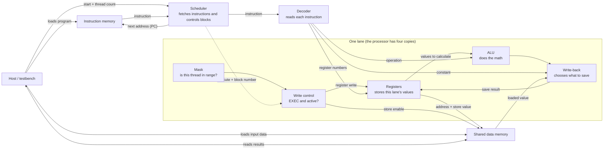

# TinyGPU: a small four-lane processor for vector addition

This project is a model of a tiny GPU-like processor written in Verilog. It runs a small program that adds two arrays:

```text
C[i] = A[i] + B[i]
```

The central idea is simple: **one instruction is sent to four lanes, and each lane applies it to its own data.** That is called SIMD/SIMT-style execution. SIMD stands for Same Instruction, Multiple Data. This project is small enough to simulate on a laptop; it is not a complete or commercially realistic GPU.

## Big Picture of TinyGPU (Architecture)



The box is one lane; the processor has four copies: lane 0, 1, 2, and 3.
Each copy has its own registers, ALU, and mask. The decoder sends the same
instruction to every copy, but each works on different values. They use the
shared data memory to load inputs and store results.

The host in this project is going to be the testbench. It loads the
program into instruction memory and the arrays into data memory, starts the processor, waits for it to finish, and checks the answers.

## What is a lane?

A **lane** is one small worker. There are four lanes in the default core. Each lane has its own:

- **Register file:** small private storage for values the lane is using.
- **ALU:** calculator for add, subtract, and multiply (needed for vector addition). (alu.v file)
- **Write-back logic:** chooses which value to save in a register.

The lanes share the instruction stream and data memory. They receive the same operation and register numbers, but their register contents can differ.
That lets them execute the same instruction on different array elements at the same time.

For example, when all lanes run `ADD`, lane 0 adds its two values, lane 1
adds its own two values, and so on. The instruction is shared; the data is
per lane.

## What happens during one instruction?

The scheduler has three states:

1. **IDLE:** Wait for the host to start the program.
2. **FETCH:** Read the instruction at the program counter (PC).
3. **EXEC:** Decode and run that instruction on the lanes.

The processor uses one FETCH cycle and one EXEC cycle per instruction.
During EXEC, the lanes' register or memory writes happen at the rising edge
of the clock. After an ordinary instruction, the scheduler advances the PC.
After `RET`, it either starts the program again for the next group of lanes,
or marks the whole job done.

In Verilog, `assign` and `always @(*)` describe logic that responds to
inputs. `always @(posedge clk)` describes stored state that changes on a
clock edge. A variable declared `reg` is not necessarily a physical
register; the clocked behavior is what makes it storage.

## How four lanes cover many elements

Each lane has a fixed lane number, called `threadIdx` here:

| Lane | `threadIdx` |
|---:|---:|
| 0 | 0 |
| 1 | 1 |
| 2 | 2 |
| 3 | 3 |

The program calculates an element index for each lane:

```text
index = blockIdx * 4 + threadIdx
```

The four lanes in block 0 process elements 0 through 3. If there are more
elements, the scheduler advances `blockIdx` and runs the same program again;
block 1 processes elements 4 through 7, and so on.

If the number of requested elements is not a multiple of four, the last
block has an out-of-range lane. The **thread mask** checks whether that
lane's index is less than the requested thread count. An inactive lane
still receives the instructions, but it cannot write a register or store
to memory.
